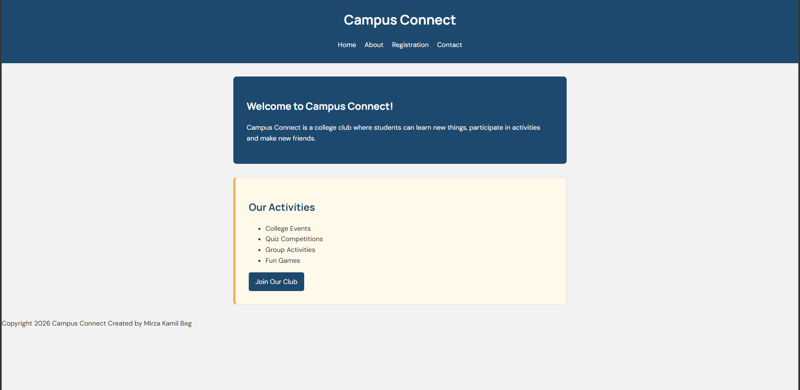
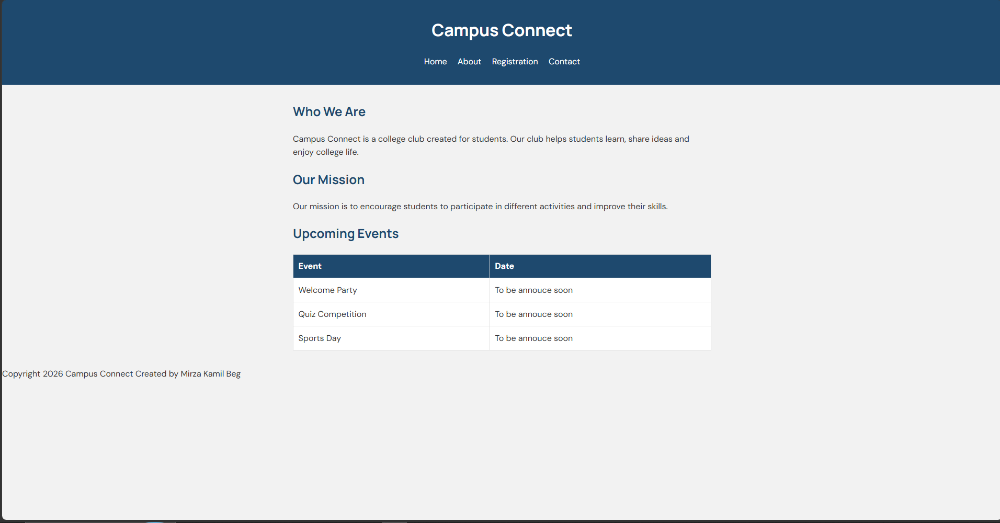
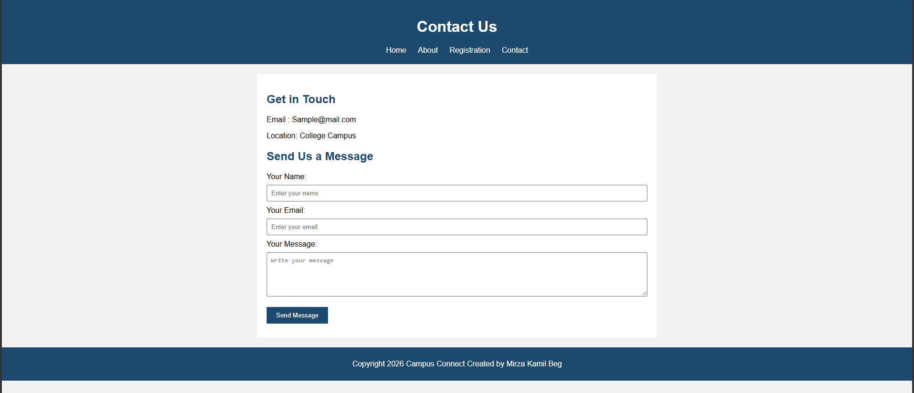
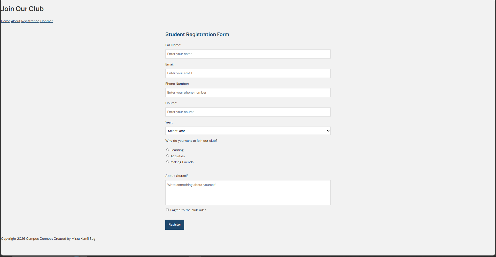

## Campus Connect - College Club Website

A simple college club website created using **HTML and CSS**.

This project is made for practicing basic web development.

## Pages

1. **Home (`index.html`)** – Introduction to the college club.
2. **About (`about.html`)** – Information about the club and upcoming events.
3. **Registration (`registration.html`)** – Student registration form.
4. **Contact (`contact.html`)** – Club contact details and message form.

## Technologies Used

- HTML
- CSS

## Project Structure

```text
campus-connect/
│
├── index.html
├── about.html
├── registration.html
├── contact.html
├── styles.css
└── README.md
```

## How to Run

1. Download or clone this repository.
2. Open the project folder in VS Code.
3. Open `index.html` in your browser.
4. Use the navigation menu to visit other pages.

## Screenshots

### Home Page


### About Page


### Contact Page


##  Registration page



**Created by:** Mirza Kamil Beg